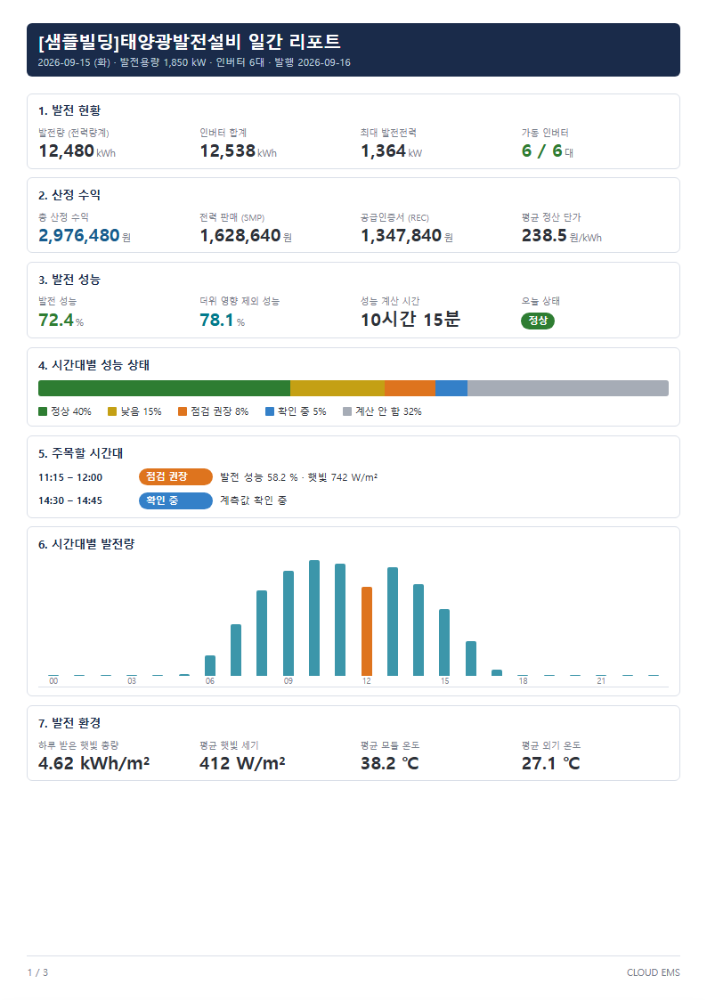
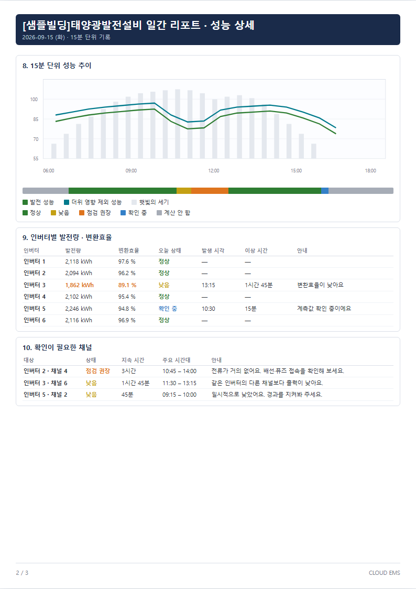
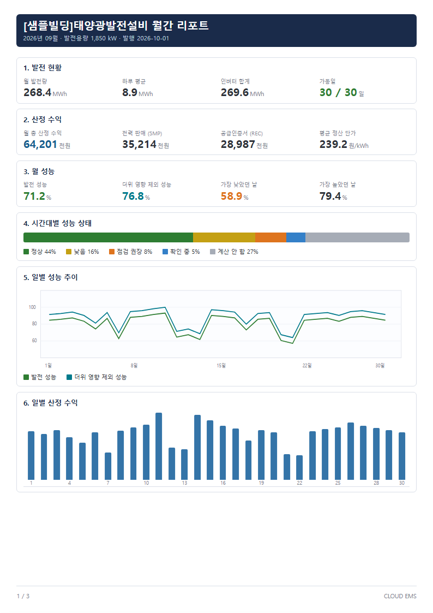
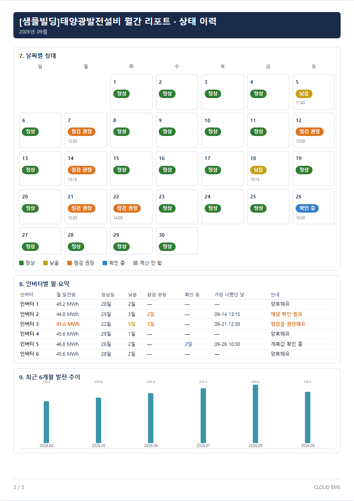
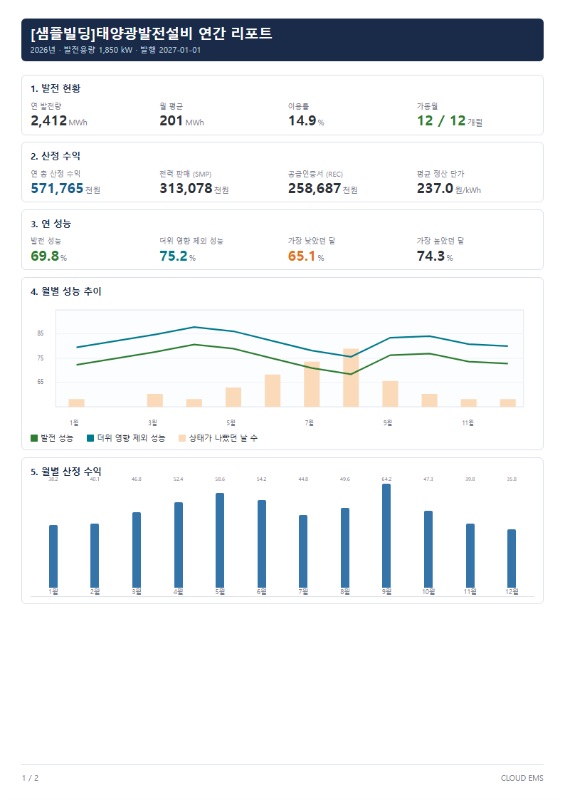

# Solar Plant Analysis Report (A4 HTML)

태양광 발전소의 **일간 · 월간 · 연간 분석 리포트 화면 샘플**입니다.
EMS 리포트 메뉴에서 PDF로 내려받는 A4 세로 지면을 전제로 설계했고, 개발팀이 그대로 구현할 수 있도록 HTML · CSS 로 지면을 확정했습니다.

> 발전소명 · 수치는 모두 Mock(`[샘플빌딩]태양광발전설비`)입니다. 실제 현장 · 고객 정보는 포함하지 않습니다.

**라이브 데모:** https://bob-joosayo.github.io/solar-report-html/ — [일간](https://bob-joosayo.github.io/solar-report-html/daily.html) · [월간](https://bob-joosayo.github.io/solar-report-html/monthly.html) · [연간](https://bob-joosayo.github.io/solar-report-html/yearly.html)

| 일간 1p · 요약 | 일간 2p · 성능 상세 |
|---|---|
|  |  |

## 배경과 역할

| 항목 | 내용 |
|---|---|
| 문제 | 기존 리포트는 발전량 위주라 전력판매 현장에서 필요한 **수익 · 성능 저하 원인** 이 빠져 있었고, PR 단순 평균은 흐린 날 · 새벽 구간이 섞여 실제 성능을 왜곡 |
| 한 일 | 리포트 설계서 작성(구성 · 집계 원칙 · 생성 시점 · 지면 표기 규칙) → 이 HTML 로 지면 확정 → 개발 전달 |
| 적용 범위 | 태양광 발전소 공통 템플릿. 제목은 발전소명, 인버터 · 채널 수는 현장별 가변 |

## 리포트 구성

| 파일 | 페이지 | 내용 |
|---|---|---|
| `daily.html` | 3p | 발전 현황 · SMP/REC 산정 수익 · 발전 성능 · 시간대별 상태 띠 · 주목할 시간대 · 15분 성능 추이 · 인버터별 변환효율 · 확인이 필요한 채널 · 일자별 데이터 |
| `monthly.html` | 3p | 월 수익 · 월 성능 · 일별 성능/수익 추이 · 날짜별 상태 캘린더 · 인버터별 월 요약 · 최근 6개월 추이 |
| `yearly.html` | 2p | 연 수익 · 월별 성능/수익 · 월별 상태 요약 · 인버터 연 요약 |
| `report.css` | – | 공통 A4 지면 스타일 (화면용 툴바는 인쇄 시 숨김) |

| 월간 1p | 월간 2p · 상태 캘린더 | 연간 1p |
|---|---|---|
|  |  |  |

## 설계 포인트

- **성능은 “계산 가능한 15분”만 평균**: 햇빛이 충분한 구간만 성능을 계산하고, 그 시간을 `성능 계산 시간 10시간 15분` 처럼 고객이 읽을 수 있는 시간으로 보여 줍니다. 평균만 보면 오해할 수 있어 **상태 비중(정상 · 낮음 · 점검 권장 · 확인 중 · 계산 안 함)** 을 함께 표시합니다.
- **닫힌 기간만 리포트에 넣기**: 일간은 다음 날, 월간은 다음 달 1일에 생성하고, 연간은 이미 만들어진 월간만 합산합니다. 진행 중인 기간이 섞여 숫자가 바뀌는 일을 막습니다.
- **대시보드와 같은 집계 원칙**: 대시보드 위젯이 저장한 15분 통계를 그대로 읽어 리포트를 만들도록 해, 화면과 리포트 숫자가 어긋나지 않게 했습니다.
- **지면에는 고객 표현만**: 개발용 코드 · 내부 용어는 설계서로 분리하고, 지면에는 “전류가 거의 없어요. 배선 퓨즈 접속을 확인해 보세요.” 같은 안내 문장만 남겼습니다.
- **월 · 연은 요약만**: 월 · 연 단위에서 효율 % 평균은 의미가 흐려져 쓰지 않고, 이상 발생일 · 건수로 대신 보여 줍니다.

## 실행

빌드가 필요 없습니다. `index.html` 을 브라우저로 열고, 각 리포트 상단의 **인쇄 / PDF 저장** 버튼으로 A4 PDF 를 만들 수 있습니다.

## 관련 저장소

- [solar-dashboard-layout](https://github.com/BOB-joosayo/solar-dashboard-layout) — 같은 발전소의 실시간 대시보드 프로토타입 (수익 · 성능 · 채널 위젯)
